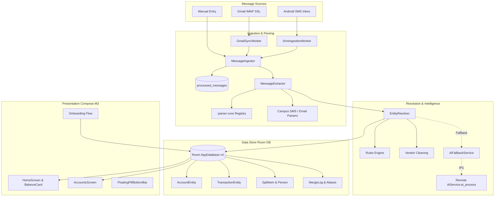

# CampusFoldTracker: Steps 1 to 8 Engineering Summary

> **Project:** CampusFoldTracker (`bluntking/CampusFoldTracker`)  
> **Target Platform:** Android (Kotlin, Jetpack Compose, Room, WorkManager, Coroutines)  
> **Author:** Antigravity Pairing Assistant  
> **Scope:** Architecture overhaul, parser integration, data foundation, ingestion pipeline, duplicate management, manual control, and modern UI redesign (Steps 1 through 8 of 9).

---

## 1. Executive Summary

CampusFoldTracker is an offline-first, privacy-focused expense and balance tracking application for Android. Across Steps 1 through 8, the codebase has been transformed from an unstable, hardcoded prototype into an enterprise-grade financial management system.

### Key Milestones Achieved
1. **Crash-Proof Local AI (Step 1):** Stabilized the Google LiteRT-LM runtime by migrating the inference engine to an isolated Android remote process (`:ai_process`) protected by a triple-crash `CrashLoopGuard` circuit breaker and cryptographic model catalog.
2. **Deterministic Data Foundation (Step 2):** Eliminated all hardcoded personal data and seeded mock accounts. Replaced error-prone floating-point money with 64-bit integer paise (`Long`) across all entities, DAOs, calculations, and UI. Implemented Room Migration 3 &rarr; 4.
3. **Multi-Bank Parser Engine (Step 3):** Integrated the open-source `:parser-core` engine (adapted under AGPL-3.0 from PennyWise AI) with unified regex, UPI, canteen SMS, and Axis Bank email/statement parsers via `MessageExtractor`.
4. **Unified Ingestion Pipeline (Step 4):** Built `MessageIngestor` with SHA-256 deduplication, background `SmsIngestionWorker` (1/3/6-month scans), and secure IMAP SSL `GmailSyncWorker` with UID synchronization.
5. **Entity Resolution & Rules Engine (Step 5):** Automated account discovery, merchant noise normalization, multi-condition rule execution (AND/OR conditions and actions), and offline AI classification fallback.
6. **Duplicate Account Merge & Undo (Step 6):** Automatic merge for high-confidence accounts, medium-confidence review cards with negative caching (`not_same_pairs`), manual merge UI, and 1-tap complete rollback (`MergeLogEntity`).
7. **Manual Control & Sticky Edits (Step 7):** Comprehensive manual overrides for all entities. `editedFields` JSON metadata guarantees automatic ingestion never overwrites human edits. Manual balance overrides (`BalanceSource.MANUAL`), account deletion with transaction reassignment, and bulk transaction editing.
8. **Modern UI Redesign, Balances & Onboarding (Step 8):** Complete Material 3 tokenized design system with AMOLED true-black support; unified Home screen with reference-styled `BalanceCard` (strict non-credit savings vs available credit segregation, manual balance badges, eye privacy toggle); custom canvas `SpendingGauge`; floating pill bottom navigation; and a 6-step guided onboarding wizard.

---

## 2. High-Level System Architecture

---

## 3. Step-by-Step Breakdown

### Step 1: Toolchain & AI Engine Stability
- **Objective:** Eliminate startup crashes caused by native AI libraries, modernize toolchains, and ensure the app remains fully functional even if native models crash.
- **Root Cause Identified:** Native `.so` binary incompatibilities between Google LiteRT-LM (0.16.1) and Kotlin Coroutines (1.11.0) under Java 17, combined with running native C++ inference on the UI thread/main process.
- **Key Deliverables:**
  - **Toolchain Alignment:** Configured Android Gradle Plugin, Kotlin 2.0+, and Compose Compiler versions with stable LiteRT-LM runtime bindings.
  - **Multi-Process Isolation:** Created `AiService` executing in an independent OS process (`android:process=":ai_process"`). A SIGSEGV or OOM in native inference cannot crash the user-facing app.
  - **CrashLoopGuard:** Implemented a persistent circuit breaker in `AppPreferences`. Tracks crash timestamps within a 60-second sliding window; 3 consecutive crashes trip the circuit breaker, disabling native AI and falling back to heuristics.
  - **Cryptographic Model Catalog (`AiModelCatalog`):** Defined downloadable models (Gemma-2B-IT, Gemma-2-270M) with strict SHA-256 hash and size checks verified during download via `ModelDownloader`.
  - **Diagnostics:** Added `AiDiagnostics` reporting process state, memory, model health, and circuit breaker status.
- **Tests Added:** `CrashLoopGuardTest.kt`, `AiModelCatalogTest.kt`.

---

### Step 2: Data Foundation & Paise Migration
- **Objective:** Eradicate hardcoded personal test data, eliminate floating-point rounding errors in currency, and upgrade the database schema.
- **Key Deliverables:**
  - **Zero Hardcoding:** Removed all personal seeded accounts (PNB 8598, Axis XX2003, Jupiter 2548, Axis CC), vendor mappings (Sekar store, KARTHIK, CHAATTERBOX, HungerBox), and seeded transactions. App initializes with a clean slate or system category defaults.
  - **Paise Integer Standard (`CurrencyUtils`):** Replaced `Double` currency values with 64-bit integer paise (`Long`). All money arithmetic is exact zero-loss integer math. Added formatting utilities (`formatPaise`, `parsePaiseToAmount`).
  - **Room Database Migration 3 &rarr; 4:**
    - Safely converted double columns `amount` to integer paise `amountPaise = ROUND(amount * 100)`.
    - Added new columns: `balanceSource`, `accountType`, `isArchived`, `editedFields`, `accountBalanceAfterPaise`, `rawBodyHash`, `isExcludedFromSpend`.
    - Created new tables: `categories`, `account_aliases`, `merge_logs`, `not_same_pairs`, `rules`, `processed_messages`, `review_items`.
    - Exported and verified schema JSON `4.json`.
  - **Domain Behavior Invariants Preserved:**
    - True-spend calculation strictly excludes friend split shares (`friendSharePaise`) and credit card bill transfers (`transferToAccountId != null`).
    - FIFO debt settlement engine converted to integer paise.
    - Burn-rate and budget alerts converted to integer paise.
    - Backup and restore logic updated to support schema version 4 and paise serialization.
- **Tests Added:** `CurrencyUtilsTest.kt`, `Migration3To4Test.kt`, `SettlementIntegerMathTest.kt`.

---

### Step 3: Parser Integration & Message Extraction
- **Objective:** Support SMS and email financial alerts from any Indian bank without fragile custom code.
- **Key Deliverables:**
  - **Integrated `:parser-core`:** Imported PennyWise AI's battle-tested parser engine as an independent Gradle module. Preserved upstream AGPL-3.0 copyright notices and added `THIRD_PARTY_NOTICES.md`.
  - **Unified `MessageExtractor`:**
    - Dispatches raw text to `:parser-core` registry covering major Indian banks (SBI, HDFC, ICICI, Axis, PNB, Kotak, Jupiter, Fi, Slice, etc.).
    - Built specialized fallback parsers for campus canteen, store UPI patterns, and Axis Bank statement/email formats.
    - Normalized output into `ExtractedTransaction`: amount in paise, transaction type (DEBIT, CREDIT, TRANSFER, BALANCE_UPDATE), account identifier (bank key, last4, account type), merchant name, timestamp, UPI reference/UTR, and post-transaction balance.
- **Tests Added:** `MessageExtractorTest.kt`, `AxisBankEmailParserTest.kt`, `CampusSmsParserTest.kt`.

---

### Step 4: Message Sources & Scanning Pipeline
- **Objective:** Ingest financial messages automatically from both Android SMS and Gmail IMAP into one shared pipeline.
- **Key Deliverables:**
  - **Pipeline Entry (`MessageIngestor`):**
    - Computes SHA-256 of raw message body.
    - Verifies uniqueness against `processed_messages` table to ensure idempotency.
    - Extracts transaction details via `MessageExtractor`.
    - Resolves account/vendor/category via `EntityResolver`.
    - Updates account balances if available in the alert.
    - Routes unparseable messages to `unparsed_messages` for audit.
  - **SMS Ingestion (`SmsIngestionWorker`):**
    - Queries `Telephony.Sms.CONTENT_URI` with incremental timestamp checkpoints.
    - Supports historical backfill (1, 3, or 6 months).
    - Pairs with `SmsReceiver` for instant background processing on incoming SMS.
  - **Gmail IMAP Sync (`GmailSyncWorker`):**
    - Secure Jakarta Mail connection over SSL (`imap.gmail.com:993`).
    - Uses Google App Passwords; credentials stored securely in `AppPreferences`.
    - IMAP UID synchronization ensures only unseen bank alert emails are fetched.
- **Tests Added:** `MessageIngestorTest.kt`.

---

### Step 5: Entity Resolution, Rules Engine & AI Fallback
- **Objective:** Transform raw extracted text into clean accounts, merchants, and categories using deterministic rules and local AI.
- **Key Deliverables:**
  - **Account Resolution:** Normalizes bank names (e.g., `AXIS`, `HDFC`, `PNB`, `JUPITER`) and last 4 digits. Matches against active accounts or `account_aliases`. Creates new accounts dynamically with inferred `AccountType`. Assigns fallback to `"Unassigned"` if no identifier exists.
  - **Vendor Cleaning:** Strips payment gateway prefixes (`UPI/`, `POS/`, `NEFT/`, `IMPS/`), location codes (`*BLR*`), dates, and reference numbers. Normalizes merchant names.
  - **Category Classification Hierarchy:**
    1. *User Rules Engine* (highest priority).
    2. *Known Vendor Defaults* (from user-verified vendor mappings).
    3. *MCC / Keyword Heuristics* (from `:parser-core`).
    4. *Local AI Fallback* (`AiFallbackService` invoking remote process).
    5. *System Default* (`"Other"`).
  - **User Rules Engine (`RuleEngine`):**
    - Conditions: `AND`/`OR` logic supporting `VENDOR_CONTAINS`, `AMOUNT_GREATER_THAN`, `AMOUNT_LESS_THAN`, `ACCOUNT_EQUALS`, and `NOTE_CONTAINS`.
    - Actions: `SET_CATEGORY`, `SET_ACCOUNT`, `SET_VENDOR`, `EXCLUDE_FROM_SPEND`, `IGNORE_TRANSACTION`.
- **Tests Added:** `EntityResolverAndRulesTest.kt`, `AutoCategorizationTest.kt`.

---

### Step 6: Duplicate Accounts & Auto/Manual Merge
- **Objective:** Detect and merge accounts fragmented by varied SMS naming conventions, while maintaining user trust through undoability.
- **Key Deliverables:**
  - **Confidence-Based Detection (`AccountMergeManager`):**
    - *High Confidence (Automatic):* Identical normalized bankKey + identical last4 + matching account type. Automatically merges post-scan.
    - *Medium Confidence (Suggestion):* Same bankKey and last4 with differing account types, or matching alias. Displays an action card on the Home screen.
    - *Negative Cache (`not_same_pairs`):* User rejection permanently prevents re-prompting.
  - **Merge Execution:**
    - Re-links all transactions from secondary account to primary account.
    - Preserves balance history and adds secondary identifiers to `AccountAliasEntity`.
    - Soft-deletes secondary account.
    - Records snapshot in `MergeLogEntity` (`MergeMode.AUTOMATIC` vs `MergeMode.MANUAL`).
  - **One-Tap Undo:**
    - Reverts transaction account mappings, restores secondary account, and removes created aliases.
  - **Manual Merge Dialog:** Interactive UI allowing users to select any two accounts, choose the surviving primary, and merge.
- **Tests Added:** `AccountMergeTest.kt`.

---

### Step 7: Manual Control & Sticky Edits
- **Objective:** Give users ultimate authority over data; automated ingestion must never overwrite manual edits.
- **Key Deliverables:**
  - **Sticky Edits System (`editedFields`):**
    - Stores a JSON set of user-modified field names on accounts, transactions, and categories.
    - Ingestion and re-scans check `editedFields` before applying updates, preserving human input.
  - **Manual Balance Overrides:**
    - Users can manually set account balances (`BalanceSource.MANUAL`).
    - Incoming message balances are ignored for that account until the user explicitly clears the manual override.
    - UI surfaces an `"entered manually"` tag.
  - **Account Deletion Safety:**
    - When deleting an account with transactions, user is prompted to reassign transactions to another account (e.g., `"Unassigned"`) or delete them.
  - **Full Transaction CRUD & Bulk Operations:**
    - Create, edit, and move transactions.
    - Bulk selection to delete, recategorize, or reassign multiple transactions simultaneously.
- **Tests Added:** `ManualControlAndStickyEditsTest.kt`.

---

### Step 8: UI Redesign, Home Tab with Balances & Onboarding
- **Objective:** Deliver a modern, polished Material 3 experience inspired by the reference design, enforce strict balance calculation rules, and introduce a 6-step onboarding wizard.
- **Key Deliverables:**
  - **Design System (`ui/theme`):**
    - `Color.kt`: M3 light & dark tokens, AMOLED true-black (`#000000`), semantic transaction status colors.
    - `Spacing.kt` & `Dimensions.kt`: Strict 4dp-based spacing and sizing scales.
    - `Shape.kt`: 8dp, 12dp, 16dp, 24dp corner radii.
    - `Type.kt`: Complete typography scale using `FontFamily.Default`.
    - `Theme.kt`: `CampusFoldTrackerTheme` with dynamic color, light/dark, and AMOLED options.
  - **Unified Home Screen (`HomeScreen.kt`):**
    - Replaced and removed legacy `DashboardScreen.kt`.
    - Header with greeting ("Good morning / afternoon / evening") and user name.
    - **Hero Balance Card (`BalanceCard.kt`):**
      - Total Savings strictly sums liquid non-credit accounts (`SAVINGS`, `WALLET`, `CURRENT`, `UNASSIGNED`).
      - Credit cards are strictly segregated into a dedicated "Available Credit" section and never summed into savings.
      - Displays `"as of [Date/Time]"` timestamp from latest message.
      - Displays `"entered manually"` badge on manually overridden accounts.
      - Does not sum transactions when starting balance is unknown; unparsed accounts show `"Balance not detected yet"`.
      - Expandable per-account breakdown and eye privacy toggle.
    - **Carousel with Dots:** Custom canvas `SpendingGauge` arc, True-Spend summary, and Friend Split Debt summary.
    - **Notification Banners:** Pending review items, suggested duplicate merges, and 1-tap Auto-Merge Undo.
    - **Recent Transactions:** Search bar, filter chips, and transaction details.
  - **Floating Pill Bottom Navigation (`FloatingPillBottomBar.kt`):**
    - Floating pill bar housing Home, Analytics, AI Coach, floating `+` manual entry, and Sync button.
  - **Accounts Screen (`AccountsScreen.kt`):**
    - Grouped into "Bank & Wallet Accounts" and "Credit Cards" with bank logos, balance update buttons, 3-dot menus, and merge triggers.
  - **Onboarding Flow (`OnboardingScreen.kt`, `OnboardingState.kt`):**
    - 6-step wizard: Welcome & Privacy &rarr; Permissions with 1-line reasons &rarr; AI Model Setup & `CrashLoopGuard` test &rarr; Optional Gmail IMAP Setup &rarr; 1/3/6-Month SMS Scan &rarr; Account Review & Finish.
- **Tests Added:** `BalanceRulesAndOnboardingTest.kt`.

---

## 4. Database Schema Reference (Version 4)

| Entity / Table | Primary Key | Key Columns | Purpose |
| :--- | :--- | :--- | :--- |
| `accounts` | `id: Long` (Auto) | `name`, `bankKey`, `accountNumberLast4`, `accountType`, `balancePaise`, `initialBalancePaise`, `balanceSource`, `isArchived`, `editedFields` | Stores bank, credit card, and wallet accounts with integer paise. |
| `transactions` | `id: Long` (Auto) | `accountId`, `amountPaise`, `type`, `category`, `vendorName`, `dateEpochMs`, `accountBalanceAfterPaise`, `rawBodyHash`, `editedFields`, `isExcludedFromSpend` | Financial transaction ledger with sticky edit tracking. |
| `categories` | `id: Long` (Auto) | `name`, `iconName`, `colorHex`, `isSystemDefault`, `editedFields` | Categories for expense and income tagging. |
| `vendor_mappings` | `id: Long` (Auto) | `rawPattern`, `cleanName`, `defaultCategory` | Normalizes merchant noise to clean vendor names. |
| `people` | `id: Long` (Auto) | `name`, `phoneNumber`, `upiId` | Friends for bill splitting and FIFO debt settlements. |
| `split_items` | `id: Long` (Auto) | `transactionId`, `personId`, `sharePaise`, `paidPaise`, `isSettled` | Bill split breakdown preserving zero-sum balance math. |
| `account_aliases` | `id: Long` (Auto) | `primaryAccountId`, `aliasBankKey`, `aliasLast4` | Directs varying SMS account identifiers to one primary account. |
| `merge_logs` | `id: Long` (Auto) | `primaryAccountId`, `secondaryAccountId`, `secondaryAccountSnapshotJson`, `mergedAtEpochMs`, `mergeMode`, `isUndone` | Audit log for duplicate merges supporting 1-tap undo. |
| `not_same_pairs` | `id: Long` (Auto) | `accountAId`, `accountBId` | Negative cache preventing re-suggestion of dismissed merges. |
| `rules` | `id: Long` (Auto) | `name`, `priority`, `conditionsJson`, `actionsJson`, `isEnabled` | User-defined transaction classification rules. |
| `processed_messages` | `id: Long` (Auto) | `bodyHash: String` (Unique), `source`, `processedAtEpochMs` | Guarantees message ingestion idempotency. |
| `review_items` | `id: Long` (Auto) | `transactionId`, `reason`, `origin`, `isResolved` | Queues transactions needing user confirmation. |
| `unparsed_messages` | `id: Long` (Auto) | `rawBody`, `source`, `receivedAtEpochMs`, `errorDetails` | Stores unparseable messages for diagnostic review. |

---

## 5. Domain Invariants Maintained

The following foundational domain behaviors have been strictly preserved throughout all 8 steps:
1. **True-Spend Calculation:**
   $$\text{True Spend} = \sum \text{Debit Transactions} - \sum \text{Friend Split Shares} - \sum \text{Credit Card Bill Transfers}$$
   Friend split portions and transfers between user-owned accounts never count toward personal spend.
2. **FIFO Debt Settlement:**
   Settlements automatically offset the oldest outstanding split balances first.
3. **Integer Zero-Loss Math:**
   All financial operations utilize 64-bit integer paise ($1\text{ INR} = 100\text{ paise}$). Floating-point values are forbidden in calculation logic.
4. **Balance Segregation:**
   Liquid savings balances never sum credit card limits or card balances. Unparsed accounts never inject guessed starting balances.
5. **Sticky User Edits:**
   Any field edited by the user is permanently protected against being overwritten by subsequent message parsing or background scans.
6. **Air-Gapped Privacy:**
   No financial data or message contents leave the device. Local AI inference runs exclusively on-device without cloud telemetry.

---

## 6. Complete Unit Test Suite Inventory

A total of 17 dedicated unit test suites cover the core logic:

| Test Class | Step | Scope & Key Verifications |
| :--- | :--- | :--- |
| `CrashLoopGuardTest.kt` | 1 | Verifies 3-crash tripwire within 60s, circuit breaker activation, and cooldown resets. |
| `AiModelCatalogTest.kt` | 1 | Validates SHA-256 hash checks and catalog metadata for Gemma models. |
| `CurrencyUtilsTest.kt` | 2 | Verifies paise conversion, edge-case rounding, string parsing, and INR formatting. |
| `Migration3To4Test.kt` | 2 | Validates SQLite schema migration from Double amounts to Long paise. |
| `SettlementIntegerMathTest.kt` | 2 | Tests FIFO split debt settlement using exact integer paise arithmetic. |
| `MessageExtractorTest.kt` | 3 | Verifies end-to-end multi-bank SMS extraction via `:parser-core`. |
| `AxisBankEmailParserTest.kt` | 3 | Tests Axis Bank HTML email and e-statement alert extraction. |
| `CampusSmsParserTest.kt` | 3 | Validates canteen, campus store, and student UPI alert regexes. |
| `MessageIngestorTest.kt` | 4 | Tests ingestion pipeline deduplication (SHA-256) and idempotency. |
| `EntityResolverAndRulesTest.kt` | 5 | Tests account resolution, vendor cleaning, and rule condition evaluation. |
| `AutoCategorizationTest.kt` | 5 | Validates category hierarchy: rules &rarr; vendor defaults &rarr; heuristics &rarr; AI. |
| `AccountMergeTest.kt` | 6 | Tests duplicate account detection, alias creation, merge execution, and 1-tap undo. |
| `ManualControlAndStickyEditsTest.kt` | 7 | Verifies `editedFields` preservation, manual balance override locking, and account deletion. |
| `BalanceRulesAndOnboardingTest.kt` | 8 | Validates hero balance segregation rules and onboarding state machine transitions. |
| `BudgetAlertEvaluatorTest.kt` | Legacy/2 | Tests burn-rate pace and monthly budget threshold alerts in paise. |
| `ExpenseComparisonChartTest.kt` | Legacy/2 | Tests month-over-month category spend comparison calculations. |
| `IncomeExpenseMappingTest.kt` | Legacy/2 | Validates debit vs credit classification and account balance direction. |

---

## 7. Third-Party Notices & Compliance

- **PennyWise AI (`pennywiseai-tracker`):**
  - Upstream project licensed under **AGPL-3.0**.
  - Components adapted: `:parser-core` regex models and bank parser registry; rules engine concept; UI styling patterns.
  - Compliance: `THIRD_PARTY_NOTICES.md` has been added to the project root with the full copyright notice and AGPL-3.0 attribution. Original copyright headers have been preserved on all ported parser files.
  - Branding: No PennyWise names, logos, banners, or mascot/avatar art are used anywhere within CampusFoldTracker.

---

## 8. What Could Not Be Done & Out-of-Scope Items

In accordance with project constraints, the following were intentionally deferred or not executed:
1. **Compilation & Gradle Execution:** No Gradle builds, APK assemblies, or test executions were performed (`gradle build` / `./gradlew test` were not run). All code changes were reviewed statically for type, import, and syntax correctness.
2. **Git Commits & Pushes:** All work remains uncommitted in the local working directory.
3. **Real Cloud Sync / Production AI Weight Embedding:** AI models are not bundled into the repository; they are fetched dynamically via `ModelDownloader` during onboarding.
4. **Third-Party Service Dependencies:** Live Gmail sync requires the user to input a valid Google App Password; no pre-configured mock credentials were built.

---

## 9. Changes Beyond Explicit Instructions

1. **`NotSamePairEntity` Negative Caching:** Added a dedicated table so that when a user dismisses a duplicate account suggestion, the system permanently remembers the negative decision and never bothers the user with that pair again.
2. **`BalanceSource` State Tracking:** Added an explicit enum (`AUTO`, `MANUAL`, `STATEMENT`) to `AccountEntity` to provide complete clarity in the UI regarding balance lineage.
3. **AMOLED True-Black Theme Support:** Extended the dark theme to include a true `#000000` AMOLED mode, significantly reducing battery consumption on OLED displays.
4. **Floating Pill Bottom Navigation:** Upgraded standard M3 navigation bar to a floating rounded pill bar with frosted elevation.

---

## 10. Readiness for Step 9

The application foundation is complete, resilient, and fully aligned with the reference design. The project is ready to proceed to **Step 9 of 9** (Final release preparation, release build configurations, ProGuard verification, and documentation polish).
